# 0004 — Home header for many sections

Date: 2026-11-01 · Status: accepted (b)

## Context
Home's header band was designed for one café menu with a desserts tab
coming. «يعني إيه؟» now explains anything: terms and history come in
Step 5, and more sections after that (0005). The band holds five things
today: the app's name and tagline, settings, search, the sections switch
and the open section's category chips.

Screenshots of the band as it is (`./scripts/screens.sh`, dark, glass in its
solid look; `SCREENS_TEXT_SCALE=1.6` for the large text):

- Phone (393×852): Arabic, scrolled, Arabic at 1.6×, scrolled at 1.6×, English
  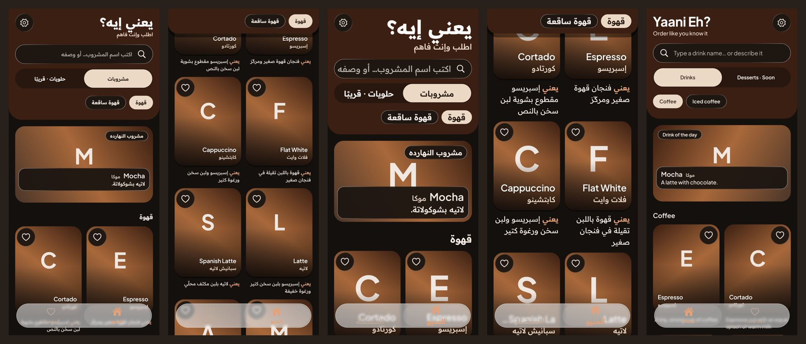
- iPad 1032×1376 (Arabic, then Arabic at 1.6×) and 1376×1032 (English)
  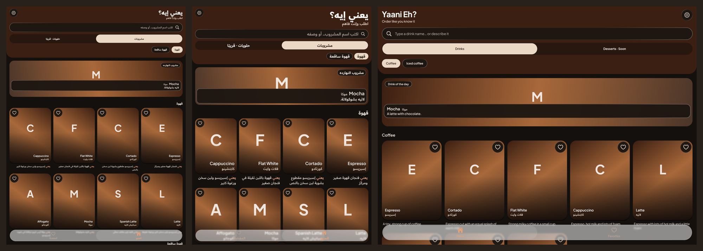

## Problems
1. **Too tall before any content.** The band takes ~34% of an iPhone 15
   screen (≈ 290 of 852 pt), and ~38% at 1.6× text. The first card starts
   below the fold's first third.
2. **The sections switch doesn't scale.** A segmented control fits two or
   three short options. With drinks, desserts, terms and history, every
   label gets a quarter of the width (≈ 80 pt on a phone). «حلويات ·
   قريبًا» already takes half the control. At 1.6× text, Arabic labels
   won't fit, and there's no room for an icon or a count.
3. **Two actions compete in the band.** Search is what people come for, but
   settings (rare: language and theme) sits in the most valuable corner.
4. **The header never shrinks.** Only the chips pin. Once you scroll, the
   section switch and search are gone: to search, scroll back to the top.
5. **Sections have no address.** A section is a state in Home
   (`selectedTabProvider`), not a page. It can't be deep-linked, and it
   resets on every switch.
6. **Tablets stretch the band.** On iPad, search and the switch run the
   full width (≈ 1,330 pt landscape) while cards use a grid. A single
   column of controls belongs in `AppReadableWidth`.
7. **The copy is café-only:** «اطلب وإنت فاهم», «اكتب اسم المشروب…», «مشروب
   النهارده», tab «المنيو». The words change in Step 4; the layout has to
   work for any section first.
8. Seen in passing: at 1.6× text, the floating tab bar's labels sit over
   the card text under it (not fixed here).

## Options
All three mocks use the same rules and content: four sections, from the
backend (drinks with 41 items, terms with 23, history with 12, desserts
with none = «جاي قريب»). Search is the only action in the band. Settings
becomes a third tab (الرئيسية · المفضلة · الإعدادات). The band shrinks on
scroll. Arabic first, touch targets ≥ 48, 1.6× text, iPad. Mocks are HTML
with the app's fonts and tokens (`0004-home-header/mock.html`, rendered by
`render_mocks.js`). The tagline and hint are placeholders until Step 4.

### a) Section cards in the band, chips under them
A horizontal scroll of section cards (icon + name + count) under search,
then the open section's chips. On scroll, the band becomes one slim bar:
a search button and the chips.

Each strip: top, scrolled, Arabic at 1.6×, English.
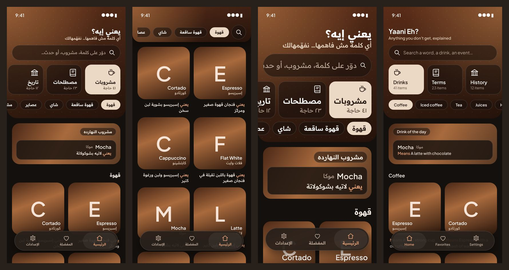
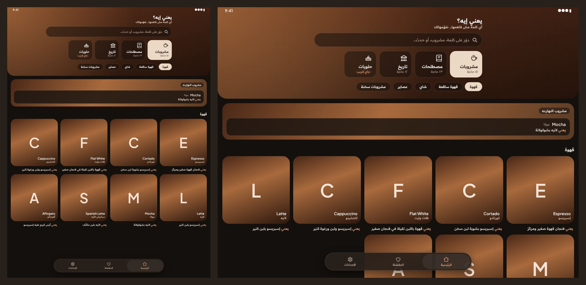

- ✅ One tap between sections, and you can see what exists.
- ❌ The band gets **taller** than today: name + search + cards + chips.
  At 1.6×, the cards show 2½ sections and the first content is half a
  screen down.
- ❌ Two rows of horizontal scrolling on top of each other (sections and
  chips) are easy to confuse. Still no deep link per section.

### b) Home as a hub, each section its own page (`/section/:slug`)
Home: a short band (name, tagline, search), then «كلمة النهارده» (from
any section), then one card per section: icon, name, count and a few
examples. An empty section shows a dashed card «جاي قريب». Tapping a card
opens the section's page, with a back button, its name and count, a
search button, its chips (pinned on scroll) and its items, as Home is
today. On scroll, Home's band shrinks to just the search field.

Each strip: Home, Home scrolled, section page, section page at 1.6×,
Home at 1.6×, English.
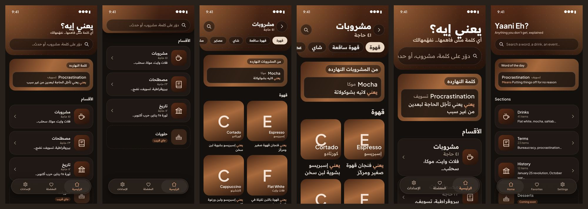
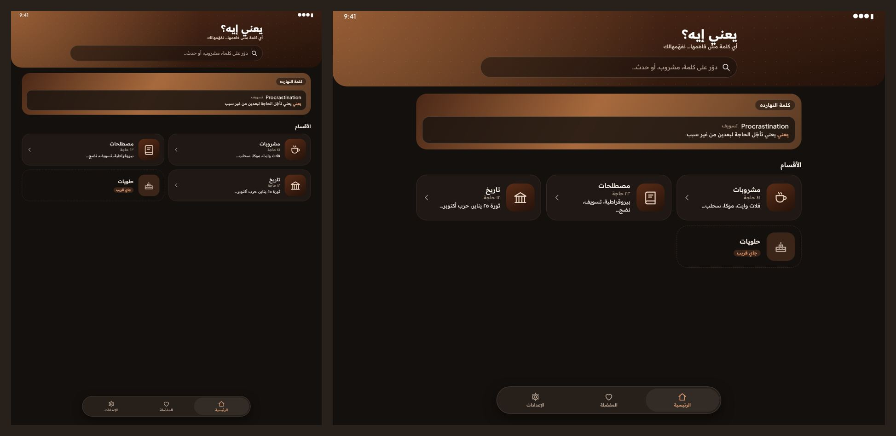

- ✅ The shortest band: search is always the first thing and stays
  pinned. Each band holds one kind of control (Home: search; section:
  chips).
- ✅ Scales to any number of sections (a list or grid, not a switch).
  Section cards read well at 1.6× and in a 2-column (portrait) or
  3-column (landscape) grid on iPad.
- ✅ Sections get deep links (`yaanieh://section/terms`) and a natural
  place for per-section analytics and «جاي قريب».
- ❌ One more tap to reach drinks (the only full section today). Mitigated
  by «كلمة النهارده» and search on Home, and by Home being where you
  start, not where you browse.
- ❌ The most work: a new route, page and security cases. The browse list
  moves to the section page.

### c) A section picker in the title
The band's title is the open section («مشروبات ⌄»), with the app's name
small above it. Tapping it opens an `AppSheet` listing every section
(icon, name, count, ✓ on the current one, «جاي قريب»). Search and chips
stay as today. On scroll: a slim bar with the picker, search button and
chips.

Each strip: top, scrolled, the sheet, Arabic at 1.6×, English.
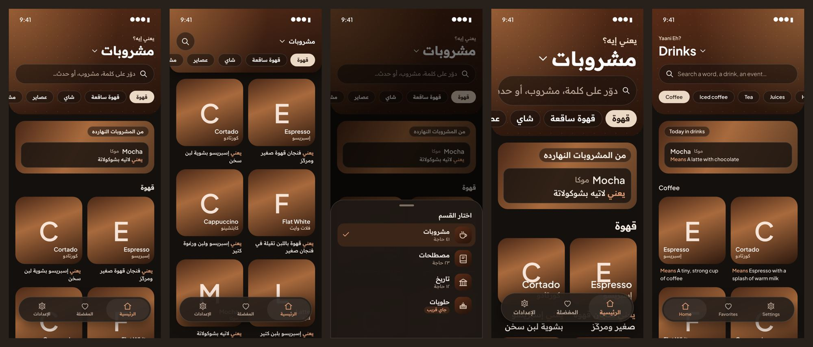
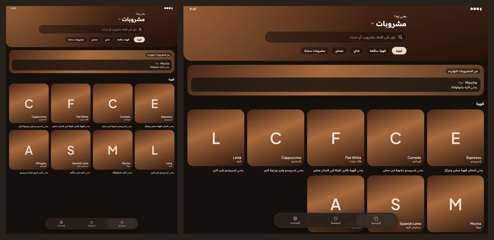

- ✅ Small change from today. The band loses the switch row, so it's
  about one row shorter. Scales to any number of sections.
- ❌ Sections are hidden behind a tap: a new user doesn't see that terms
  and history exist, which is the product's point.
- ❌ The title «مشروبات» replaces the app's name as the headline, so the
  first screen reads as a café app again. Still no deep link per section.

## Recommendation
**b (hub)**, with search on top of every screen, matching your lean. It
fixes problems 1–6 together. It keeps the browse list as it is, now on
the section page, and it is the only option that shows a new user every
section at a glance. If b is picked, it also adds:
- `AppRoutes.section` (`/section/:slug`), `app_router.dart` and
  `docs/deep_links.md`, plus a `test/security/deep_link_test.dart` case
  (unknown slug → not-found page, hostile slug → rejected by
  `AppRoutes.slugPattern`).
- Settings as a third tab; `/settings` keeps working as a link.
- `docs/design.md` (hub band, section card, section page) and
  `docs/features/browse.md` (flows, analytics: `browse_section_selected`
  becomes "a section card is opened").

## Decision
**b, Home as a hub** (picked 2026-11-01).
- Home (`/`, `BrowseView`): a short band with the app's name, tagline and
  search (the only action), then the item of the day from any section,
  «الأقسام» and one `SectionCard` per section from the backend (icon from
  `categories.icon` via `AppIcons.forSection`, name, count, the first
  three names). An empty section shows «جاي قريب» and still opens. Once
  the band scrolls away, search stays pinned (`PinnedBar`).
- A section (`/section/:slug`, `SectionView`): band with back, name, count
  and a search button, then its chips; on scroll a slim bar keeps back,
  the chips and search. The list itself is today's, unchanged. It stays
  under the tab bar (same branch as Home).
- Settings is the third tab (الرئيسية · المفضلة · الإعدادات).
- iPad: the band's content in `AppReadableWidth`; section cards in a grid
  with at least `AppDimens.sectionCardMinWidth` (360) per card (1 column on
  a phone, 2 in portrait, 3 in landscape), at most `AppDimens.hubMaxWidth`.
- Analytics: `browse_section_selected` is replaced by
  `browse_section_opened` (`section`, `coming_soon`).
- Found on the way: on a short phone `AppDimens.searchHeight` (`48.h`) was
  ~34 pt, under the 48 pt touch target; it's now at least 48.
- Not changed here (Step 4): the café wording («اطلب وإنت فاهم», the search
  hint, «مشروب النهارده»).

## As built
`./scripts/screens.sh` after the change (glass in its solid look):
Home, Home scrolled, a section, its cards, an empty section.
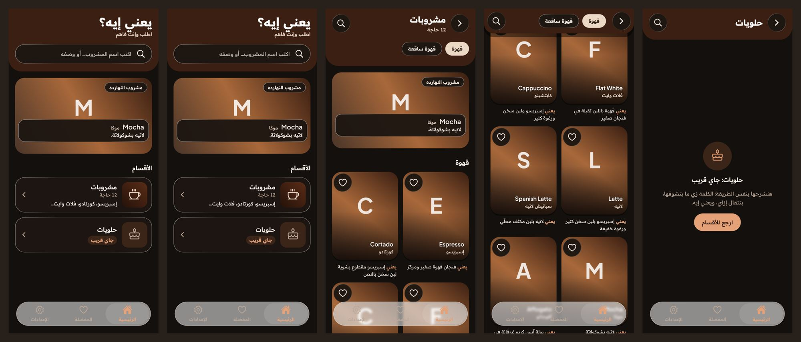
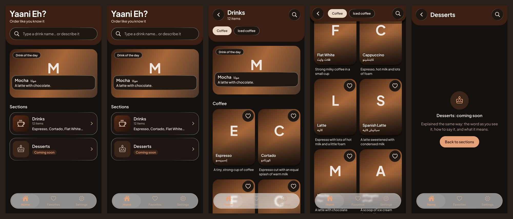

At 1.6× text (393 pt and 320 pt), and the Settings tab:
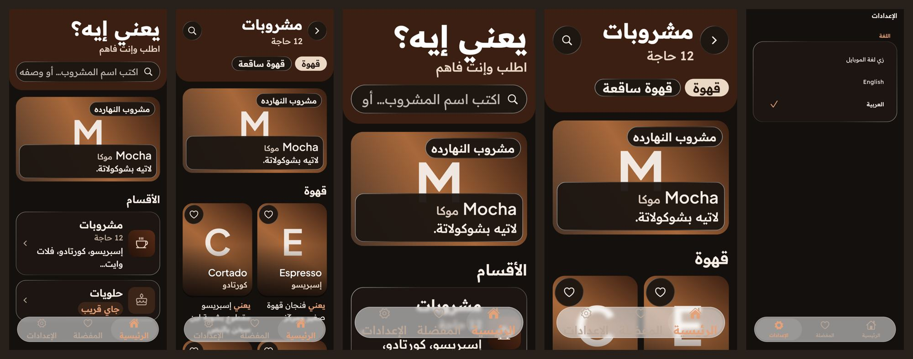

iPad 1032×1376, 1376×1032 (Home and a section), 1032×1376 at 1.6×:
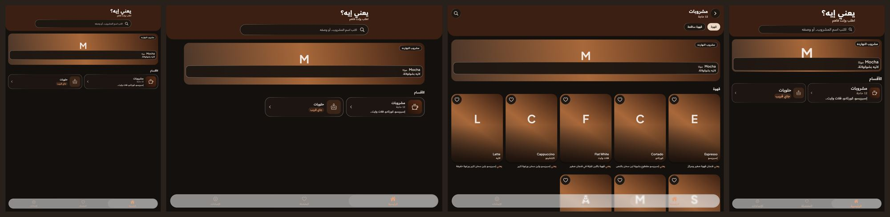
